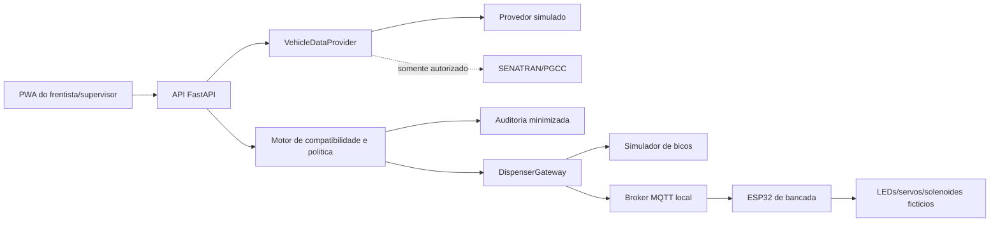
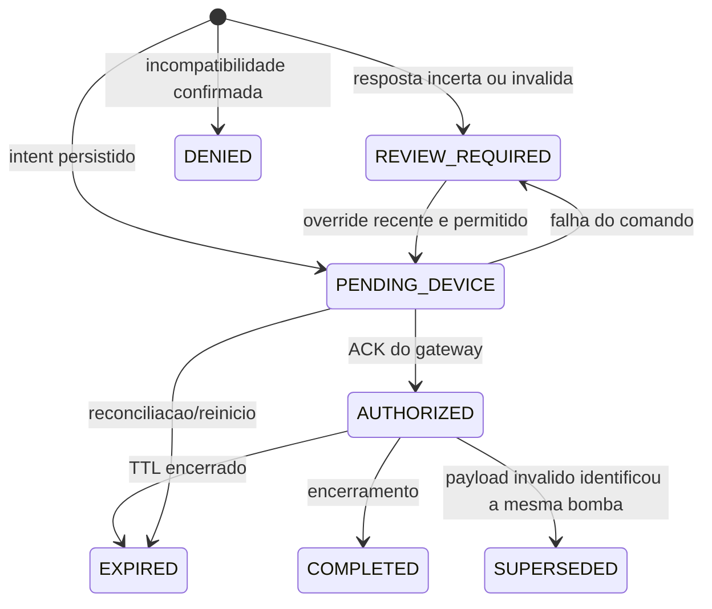

# Arquitetura do prototipo

## Limite de seguranca

O prototipo serve exclusivamente para bancada seca, em baixa tensao e sem
atmosfera inflamavel. Uma aplicacao real deve ser redesenhada com fabricante da
bomba, integrador habilitado, profissional de seguranca e equipamentos
certificados para a classificacao do local.

## Componentes

O frontend nunca acessa a SENATRAN nem o dispositivo diretamente. O provedor
veicular retorna somente uma representacao interna de combustiveis compativeis.
O gateway recebe apenas autorizacao, identificador de bico e validade.

## Estados implementados no MVP

`QUERYING`, `DISPENSING`, `LOCKED`, `DeviceAck` persistente, `PolicyVersion` e
identidade individual pertencem a arquitetura-alvo; ainda nao sao estados ou
entidades persistidos neste MVP. O ACK atual e sincrono no gateway simulado.

## Ameacas e controles iniciais

| Ameaca/falha | Consequencia | Controle |
|---|---|---|
| resposta veicular ausente ou desconhecida | liberacao incorreta | `REVIEW_REQUIRED`, nunca fail-open |
| codigo de combustivel novo | mapeamento incorreto | tabela versionada e desconhecido bloqueado |
| comando MQTT repetido | segundo acionamento | `command_id` idempotente |
| comando atrasado | acionamento fora da ordem | `sequence` monotônica por dispositivo/sessao, TTL local e rejeicao de replay |
| perda de rede/energia | estado indefinido | bloqueio local por TTL e inicializacao em `LOCK_ALL` |
| credencial exposta | consulta ou override indevido | segredo externo, menor privilegio e rotacao |
| placa nos logs | risco LGPD | uso transitorio e log sem placa/resposta bruta |
| supervisor compartilhado | override sem autoria confiavel | MVP restrito a localhost; identidade individual e RBAC sao obrigatorios antes de uso multiusuario |
| timeout da PWA | resposta desconhecida e repeticao do comando | `client_request_id` idempotente e reconciliacao manual com a mesma chave |

## Decisao para instalacao real

A trava mecanica de bancada representa o intertravamento, mas nao define a
solucao industrial. Para um piloto real, a primeira alternativa a avaliar e a
autorizacao eletronica por controlador de pista/dispenser. Servo, ESP32 e tablet
comuns nao devem ser levados para a zona de abastecimento.
