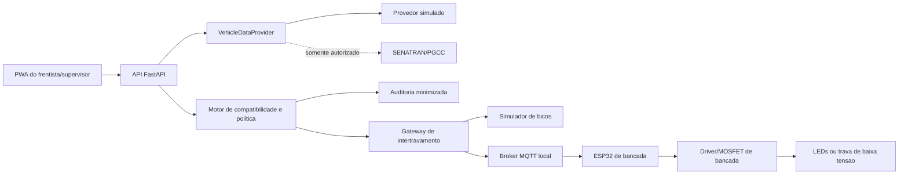
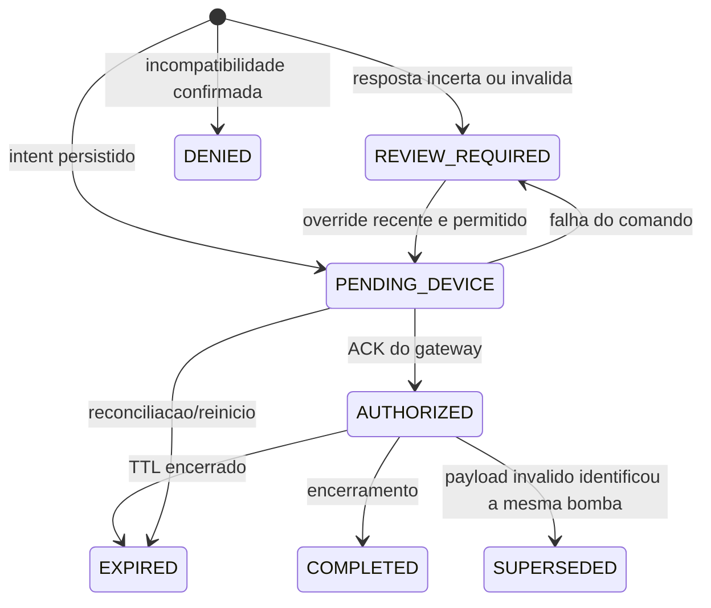

# Arquitetura do prototipo

## Limite de seguranca

O prototipo serve exclusivamente para bancada seca, em baixa tensao e sem
atmosfera inflamavel. O projeto atua somente em uma trava fisica independente
no suporte do bico: nao comanda bombeamento e nao se integra a automacao ou ao
controlador de pista da empresa. Uma aplicacao real desse intertravamento
independente exigiria projeto de engenharia proprio, analise da area
classificada, profissionais habilitados e equipamentos certificados para a
classificacao do local.

## Componentes

O frontend nunca acessa a SENATRAN nem o dispositivo diretamente. O provedor
veicular retorna somente uma representacao interna de combustiveis compativeis.
O gateway recebe apenas autorizacao, identificador de bico e validade. O nome
`DispenserGateway` permanece na interface do codigo por compatibilidade, mas o
seu papel neste projeto e exclusivamente comandar a trava do suporte; ele nao
aciona dispenser, vazao ou bomba.

## Estados implementados no MVP

`QUERYING`, `LOCKED`, `DeviceAck` persistente, `PolicyVersion` e
identidade individual pertencem a arquitetura-alvo; ainda nao sao estados ou
entidades persistidos neste MVP. O backend possui gateway simulado e adaptador
MQTT; ambos so confirmam a operacao depois de um ACK coerente. O adaptador MQTT
foi coberto por cliente falso nos testes, mas o broker e o ESP32 emulado ainda
nao foram ensaiados em conjunto. Esse ACK confirma que o comando foi aceito e
que a saida GPIO correspondente assumiu o estado informado; ele nao confirma
movimento do solenoide, retirada do bico ou travamento mecanico.

## Bancada digital

A PWA possui uma visualizacao independente da tela operacional. Ela representa
uma bomba cenografica, cinco mangueiras e bicos em seus suportes, as travas,
GPIOs, estado do controlador, TTL e a sequencia
`PWA -> FastAPI -> gateway -> ESP32 -> GPIO`. Em modo demonstrativo, os eventos
sao produzidos no navegador e aparecem explicitamente como simulacao visual.
Com o backend ativo, a tela le telemetria do gateway simulado ou do adaptador
MQTT. Nenhuma placa ou resposta veicular e enviada ao dispositivo.

A retirada e a devolucao exibidas nessa planta sao estados locais do navegador,
nao telemetria mecanica. Se o TTL expirar, houver emergencia ou a comunicacao
for perdida enquanto o bico estiver fora do suporte, a interface mantem o bico
fora, mostra a saida desenergizada e solicita sua devolucao; ela nunca simula um
retorno fisico automatico. Um microswitch ou sensor Hall por suporte podera ser
avaliado futuramente para observar presenca real, mas nao faz parte da
implementacao atual.

## Ameacas e controles iniciais

| Ameaca/falha | Consequencia | Controle |
|---|---|---|
| resposta veicular ausente ou desconhecida | liberacao incorreta | `REVIEW_REQUIRED`, nunca fail-open |
| codigo de combustivel novo | mapeamento incorreto | tabela versionada e desconhecido bloqueado |
| comando MQTT repetido | segundo acionamento | `command_id` idempotente |
| comando atrasado | acionamento fora da ordem | `sequence` monotônica por dispositivo/sessao, TTL local e rejeicao de replay |
| perda de rede/energia | comando ou posicao mecanica desconhecida | saidas desenergizadas por TTL e inicializacao em `LOCK_ALL`; devolucao manual se o bico ja estiver fora |
| credencial exposta | consulta ou override indevido | segredo externo, menor privilegio e rotacao |
| placa nos logs | risco LGPD | uso transitorio e log sem placa/resposta bruta |
| supervisor compartilhado | override sem autoria confiavel | MVP restrito a localhost; identidade individual e RBAC sao obrigatorios antes de uso multiusuario |
| timeout da PWA | resposta desconhecida e repeticao do comando | `client_request_id` idempotente e reconciliacao manual com a mesma chave |

## Decisao de escopo fisico

As figuras a seguir são ilustrações conceituais da trava. A validação de
software usa a bancada digital.

- [Vista inicial do suporte](figures/trava-suporte-conceito-v1.png)
- [Alternativa com pino transversal](figures/trava-suporte-conceito-v2-pino-transversal.png)
- [Corte técnico do conceito](figures/trava-suporte-conceito-v3-corte-tecnico.png)

A trava mecanica de bancada representa um pino acionado por solenoide que impede
a retirada do bico de seu suporte. Essa e uma solucao independente: nao envia
comando de bombeamento e nao altera a automacao da empresa. A bancada nao define
um mecanismo pronto para pista. Qualquer piloto futuro manteria esse limite
funcional e dependeria de componentes, invólucros, instalação e projeto
certificados para a area classificada. Servo, ESP32 e tablet comuns nao devem
ser levados para a zona de abastecimento.
